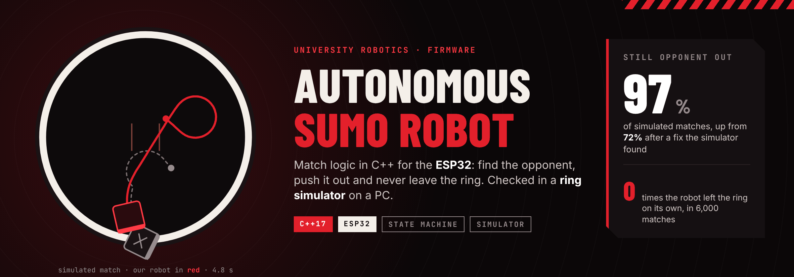
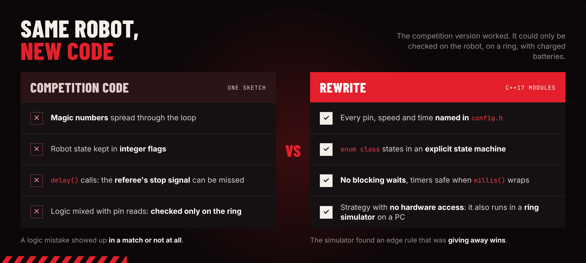
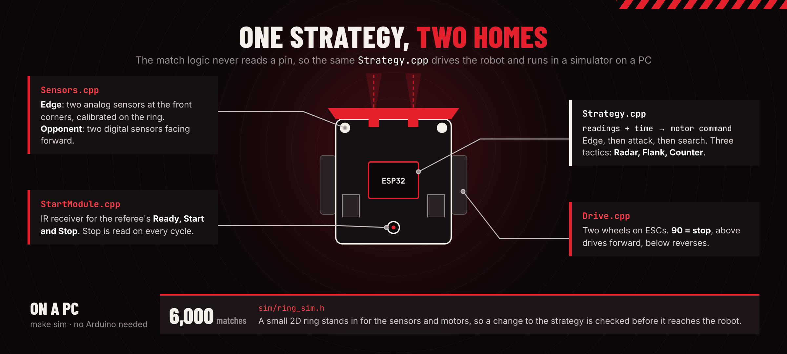
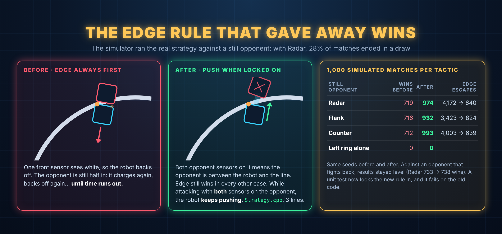

# Robot Sumo Competition



Firmware for an autonomous sumo robot, from my time competing in university robotics. The robot has to find the opponent in a round ring, push it out and never leave the ring itself.

| | |
|---|---|
| **Problem** | The competition code worked, but it could only be checked on the robot, on a ring, with charged batteries. A logic mistake showed up in a match or not at all. |
| **Where** | University robotics competitions, while studying engineering at FACENS (Sorocaba, Brazil). |
| **Solution** | The code rewritten in clear modules, with the match logic separated from the hardware, so the same logic also runs in a ring simulator on a PC. |
| **Result** | The simulator found an edge rule that was throwing away wins. After the fix, a still opponent is pushed out in 97% of simulated matches instead of 72%, and the robot never left the ring on its own in 6,000 matches. |
| **Tools** | C++ · ESP32 · Arduino |

> These are simulator results, not results from a real competition.

---

## The problem



An autonomous sumo robot has no remote control during the match: every decision comes from what its sensors read a few milliseconds earlier. Leaving the ring loses the match at once, so seeing the white border has to override everything else.

The original code mixed the match logic with the hardware, so the only way to check a change was to put the robot on a ring.

## How it works



The match logic (`Strategy.cpp`) never touches the hardware. It receives the sensor readings and the time, and returns a motor command. On the robot, the sensor and motor modules sit around it. On a PC, a small ring simulator does.

On every update the priority is fixed:

```
  edge seen?          -> back off, turn away, search again
  opponent in view?   -> attack, steering toward the sensor that sees it
  neither             -> search
```

The repository follows the robot step by step:

| Project | What it adds |
|---|---|
| [01 · PS4 integration](01-ps4-integration) | Driving by hand with a PS4 controller, to check wiring and motors |
| [02 · Strategy](02-strategy) | Autonomous mode: start signal from the referee, search, attack and edge escape |
| [03 · Final](03-final) | Separate modules, three tactics (Radar, Flank, Counter) and the ring simulator |

## Results



The simulator plays 1,000 matches per tactic and opponent with the real strategy:

| Tactic | Still opponent pushed out (after the fix) | Before the fix |
|---|---|---|
| Radar | 974 of 1,000 | 719 |
| Flank | 932 of 1,000 | 716 |
| Counter | 993 of 1,000 | 712 |

**The fix:** when both opponent sensors are on the target and a front sensor sees the white border, it is the opponent going out, not the robot. The old code backed off there; now it keeps pushing.

## Files

| Folder | What is in it |
|---|---|
| `01-ps4-integration/` | Manual driving, one sketch |
| `02-strategy/` | First autonomous version |
| `03-final/` | Final firmware in modules, and the simulator in `sim/` |
| `docs/` | Images |

To run the simulator on a PC (needs `g++` and `make`):

```bash
cd 03-final
make sim
```

Hardware: ESP32, two motors on ESCs, two opponent sensors, two edge sensors, an IR start module and a PS4 controller. Each project's README has its pins and controls.

## Background

I programmed this robot for university robotics competitions. Projects 01 and 02 are rewrites of code that ran on the robot.

---

Lucas Fernandes Nunes · [LinkedIn](https://www.linkedin.com/in/lucasfernandesnunes) · [Portfolio](https://lucasnunesf.notion.site/Lucas-Nunes-Data-BI-Analyst-3de917c89c178092885cf639b619767b)
