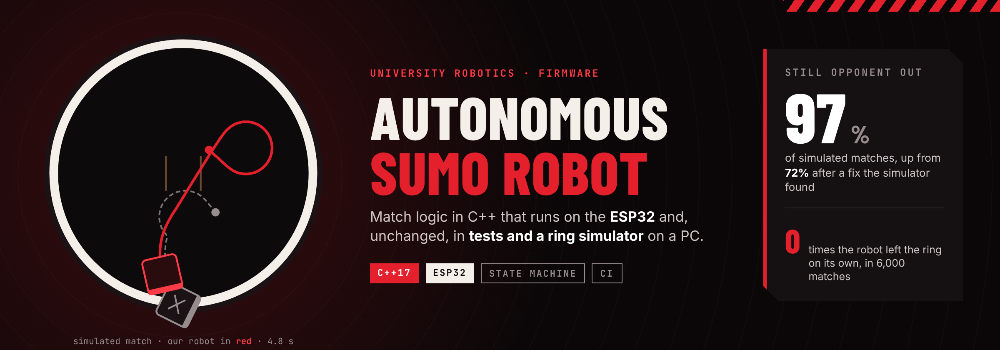
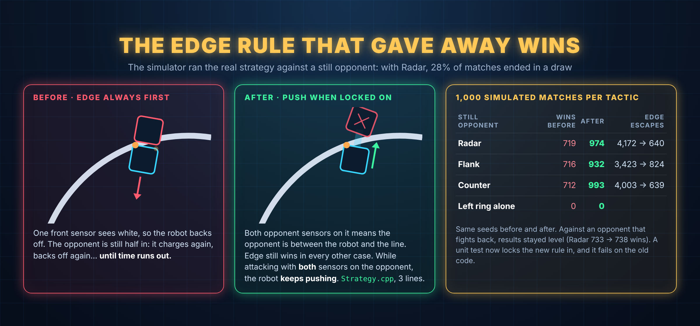
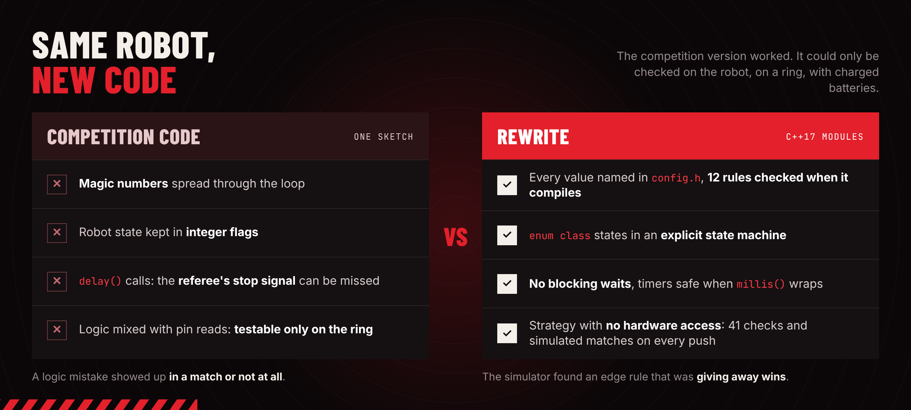
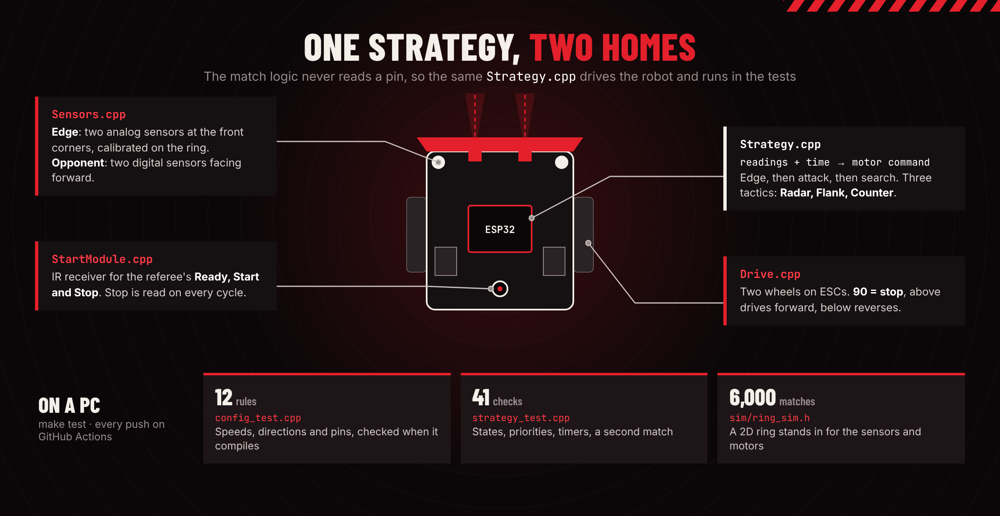

# Robot Sumo Competition

Firmware for an autonomous sumo robot, from my time competing in university robotics. The match logic runs on an ESP32 and, unchanged, in tests and a simulator on a PC, so every change is checked before it reaches the ring.




[](https://github.com/lucasnunesf/robot-sumo-competition/actions/workflows/tests.yml)

## At a glance

| | |
|---|---|
| **Result** | A simulator built for this rewrite found an edge rule that was throwing away wins. After the fix, a still opponent is pushed out in 97% of simulated matches instead of 72%, and the robot never left the ring on its own in 6,000 simulated matches. These are simulator results, not results from a real competition |
| **My role** | I programmed the robot: manual control, sensors, start module and match strategy. This rewrite adds the module split, tests, simulator and CI |
| **This repo** | Three standalone Arduino sketches that follow the robot from driving it by hand to a full match strategy, plus a test suite that runs on GitHub Actions |
| **Skills** | C++17, embedded systems (ESP32), state machines, unit testing, simulation, GitHub Actions, measuring a change before shipping it |
| **More** | [Portfolio](https://lucasnunesf.notion.site) |

> **Why a rewrite?** The competition code was written to work by a deadline. Afterwards I went back through it to sharpen my C++ and to test the decisions I made under pressure. Projects 01 and 02 are rewrites of code that ran on the robot.

## Results



`make sim` runs the real strategy through 1,000 simulated matches per tactic and opponent, with fixed seeds:

| Tactic | Still opponent: wins | Before the fix | Opponent that fights back: wins / losses |
|---|---|---|---|
| Radar | 974 | 719 | 738 / 115 |
| Flank | 932 | 716 | 663 / 161 |
| Counter | 993 | 712 | 447 / 240 |

Against a still opponent nothing can push the robot, so a loss there would mean it drove itself out. That number is 0 in every row, before and after.

The simulator also says something about the tactics: Counter, which waits for the opponent to come in, is the best against a still target and the worst against an active one. That is the trade-off it was designed around, now with numbers on it.

These are simulated results. The ring follows the official size, but robot speed and sensor range are rough values, not measured ones.

## The problem



An autonomous sumo robot has to find the opponent in a round ring, push it out and stay in itself. Once the referee starts the match nobody controls it: every decision comes from what the sensors read a few milliseconds earlier. Leaving the ring loses the match at once, so the edge has to override everything else.

The original code worked, but it could only be tested on the robot, on a ring, with charged batteries. A logic mistake showed up in a match or not at all.

## How it works



The key choice is that `Strategy` never touches the hardware. It receives the sensor readings and the time, and returns a motor command. On the robot, `Sensors` and `Drive` sit on either side of it. On a PC, the tests and the simulator do.

| Project | What it adds | Files |
|---|---|---|
| [01 · PS4 integration](01-ps4-integration) | Driving by hand with a PS4 controller over Bluetooth, to check wiring and motors | one sketch |
| [02 · Strategy](02-strategy) | Autonomous mode: IR start module, search, attack and edge escape as a non-blocking state machine | sketch + `config.h` |
| [03 · Final](03-final) | Separate modules, three tactics (Radar, Flank, Counter), tests and simulator | modules, `test/`, `sim/` |

On every update the priority is fixed:

```
  edge seen?          -> back off, turn away, search again
  opponent in view?   -> attack, steering toward the sensor that sees it
  neither             -> run the tactic's search
```

The one exception is the fix above: while attacking with both opponent sensors on the target, a front edge sensor seeing white means the opponent is going out, not the robot, so it keeps pushing.

## Design decisions

**Logic without hardware.** Splitting `Strategy` from `Sensors` and `Drive` is what makes everything else possible: unit tests, the simulator and CI. The hardware modules stay small enough to check by reading.

**A state machine with no `delay()`.** The referee's stop signal and the sensors are read on every cycle. A blocking delay in the old code could miss them.

**Timing that survives `millis()` wrapping.** Every timer uses unsigned subtraction, and a test starts a match just before the counter wraps.

**Config checked at compile time.** All pins, speeds and times are named constants in `config.h`. Twelve `static_assert` rules stop a bad retune from compiling: a speed outside the ESC range, a reverse that drives forward, two parts on one pin, or an edge sensor on an ADC pin that stops working when Bluetooth is on.

**Measure before changing the robot.** The edge fix changes how the robot behaves at the border, which is where matches are lost. It went in only after the simulator showed more wins with no extra self-exits, and a unit test now holds it in place (it fails on the old code).

## Try it

Needs only `g++` and `make`, no Arduino.

```bash
git clone https://github.com/lucasnunesf/robot-sumo-competition.git
cd robot-sumo-competition/03-final
make test
```

```
config.h checks passed (12 rules, checked at compile time).
All strategy tests passed (41 checks).
ok    Radar   never leaves the ring on its own (289 wins / 300)
ok    Radar   pushes a still opponent out in >= 85% of matches
ok    Flank   never leaves the ring on its own (282 wins / 300)
ok    Flank   pushes a still opponent out in >= 85% of matches
ok    Counter never leaves the ring on its own (295 wins / 300)
ok    Counter pushes a still opponent out in >= 85% of matches
ok    Radar wins at least 3x more than it loses to a chaser
All match tests passed.
```

```bash
make sim
```

```
1000 simulated matches per row, seed 42

tactic   opponent   wins losses draws   median win  edge escapes
Radar    still       974     0    26       4.19 s           640
Radar    chasing     738   115   147       4.87 s          1565
Flank    still       932     0    68       5.17 s           824
Flank    chasing     663   161   176       5.86 s          1865
Counter  still       993     0     7       5.92 s           639
Counter  chasing     447   240   313       4.39 s          1081

left the ring on its own: 0
```

The 6,000 matches take about 3 seconds. `./build/run_matches 1000 42 --csv` writes one line per match for analysis.

## Tests

Three levels, all run by `make test` on every push with GitHub Actions:

| File | Level | What it checks |
|---|---|---|
| `test/config_test.cpp` | compile time | 12 rules on `config.h`: ESC range, directions, pins, timings |
| `test/strategy_test.cpp` | unit | 41 checks: each opening plan, Counter's wait, attack steering, edge priority, the push-through exception, escape turns, a second match starting clean, `millis()` wrap-around |
| `test/match_test.cpp` | end to end | Whole matches in the simulator: no self-exits, at least 85% wins against a still opponent, Radar winning 3 times more than it loses to an active one |

<details>
<summary><b>The simulator</b></summary>

`03-final/sim/ring_sim.h` is a small 2D model, not a physics engine:

- Ring 154 cm across with a 5 cm white border, as in the standard rules
- Two round robots, 20 cm across, with a 60 ms motor lag
- Two forward beams for the opponent (60 cm range) and two front points for the edge, placed roughly where they are on the robot
- On contact, the robot moving faster toward the other one wins the shove
- The active opponent is the same strategy (Radar) with motors at 60% of ours

It answers one question: does the strategy, exactly as compiled for the robot, find the opponent, push it out and stay in? It cannot replace tuning on a real ring.

</details>

<details>
<summary><b>Hardware and build</b></summary>

ESP32, two motors on ESCs, two digital opponent sensors, two analog edge sensors, an IR start module and a PS4 controller.

| Part | Connection |
|---|---|
| Left / right motor ESC | GPIO 27 / 26 |
| Opponent sensors | GPIO 17 (left), 16 (right) |
| Edge sensors | GPIO 34 (left), 35 (right), on ADC1 |
| IR start module | GPIO 23 |

Arduino IDE with the ESP32 board package and the libraries `ESP32Servo`, `PS4Controller` and `IRremote` 2.x. Each project's README has its controls and pins.

</details>

<details>
<summary><b>Repository structure</b></summary>

```
robot-sumo-competition/
├── 01-ps4-integration/      # manual driving, one sketch
├── 02-strategy/             # first autonomous version
├── 03-final/
│   ├── 03-final.ino         # wires the modules, PS4 modes
│   ├── config.h             # every pin, speed, time and IR code
│   ├── Strategy.*           # match logic, no hardware access
│   ├── Sensors.*, Drive.*, StartModule.*
│   ├── sim/                 # ring simulator and match runner
│   ├── test/                # config, unit and match tests
│   └── Makefile             # make test, make sim
├── docs/                    # images used in this README
└── .github/workflows/       # runs make test on every push
```

</details>

## Tech stack

C++17 · ESP32 · Arduino (ESP32Servo, PS4Controller, IRremote) · Make · GitHub Actions

## Next steps

- [x] Tests that run on a PC, with CI
- [x] A simulator to compare tactics and check changes
- [ ] Tune the Flank and Counter timings on a real ring (their values in `config.h` are starting points)
- [ ] Compile the Arduino sketches in CI as well

## How this was built

The problem, the business rules and the design decisions are mine. They come from programming this robot for university robotics competitions. I used an AI coding assistant to write the code faster and reviewed the result.


## Author

**Lucas Fernandes Nunes** · Data & BI Analyst · moving to Lisbon in February 2027
[LinkedIn](https://linkedin.com/in/lucas-fernandes-nunes-335867256) · [Portfolio](https://lucasnunesf.notion.site)
